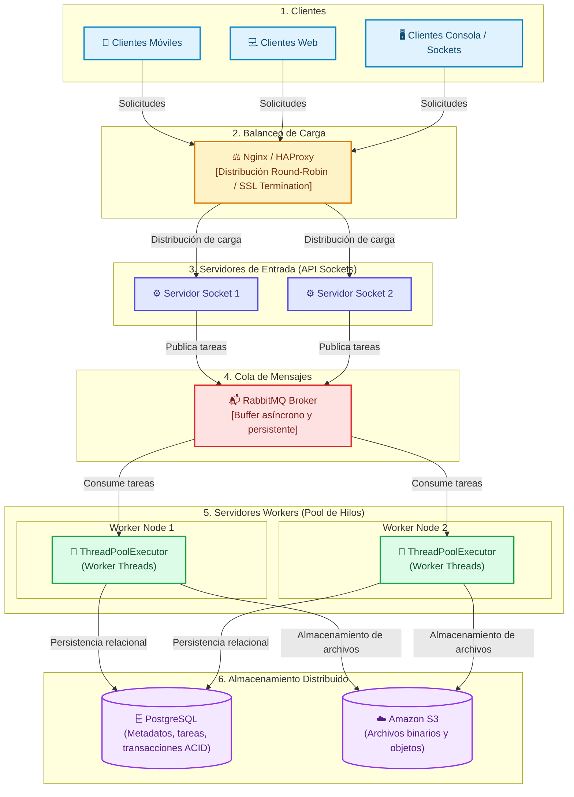

# PFO 3: Rediseño como Sistema Distribuido (Cliente-Servidor)

Este proyecto rediseña un sistema clásico de procesamiento en una **arquitectura distribuida de alta disponibilidad** utilizando sockets TCP en Python, balanceo de carga, colas de mensajería y persistencia escalable.

---

## 1. Diagrama de la Arquitectura Distribuida

El sistema desacopla la recepción de solicitudes, el despacho asíncrono y el cómputo pesado mediante capas especializadas:



---

## 2. Justificación Técnica de los Componentes

* **Clientes (móviles, web y sockets):** Capa de presentación que interactúa de manera transparente con el sistema. No requieren conocer la dirección física de los nodos de cómputo (transparencia de localización).
* **Balanceador de carga (Nginx / HAProxy):** Expone un punto único de entrada y distribuye el flujo entrante hacia los servidores disponibles. Previene cuellos de botella y ofrece tolerancia a fallos ante caídas de nodos individuales.
* **Cola de mensajes (RabbitMQ):** Permite el desacoplamiento temporal y espacial entre el servidor receptor y los nodos de procesamiento. Almacena las tareas entrantes en un buffer seguro, garantizando que ninguna solicitud se pierda durante picos de tráfico.
* **Servidores Workers con Pool de Hilos:** Cada worker ejecuta un número controlado de hilos reutilizables (`ThreadPoolExecutor`), optimizando el uso de CPU y memoria sin incurrir en la sobrecarga de instanciar un hilo por cada cliente conectado.
* **Almacenamiento Distribuido (PostgreSQL y S3):**
  * **PostgreSQL:** Gestiona la persistencia de datos relacionales, estados de procesamiento y transacciones consistentes.
  * **Amazon S3:** Almacena objetos, archivos binarios y reportes pesados fuera del servidor de aplicación, manteniendo la infraestructura sin estado (*stateless*).

---

## 📊 3. Análisis Comparativo: Monolito (PFO 2) vs. Sistema Distribuido (PFO 3)

| Criterio de Comparación | Monolito Centralizado (PFO 2) | Arquitectura Distribuida (PFO 3) |
| :--- | :--- | :--- |
| **Protocolo y Comunicación** | HTTP / REST síncrono mediante endpoints en Flask (`POST`, `GET`). | Sockets TCP directos (`SOCK_STREAM`) para control de bajo nivel + cola de mensajes (RabbitMQ). |
| **Punto Único de Fallo (SPOF)** | **Alto:** Si el proceso `servidor.py` cae, todo el sistema queda inoperativo. | **Bajo:** Nodos redundantes detrás de un balanceador y colas persistentes aseguran alta disponibilidad. |
| **Escalabilidad** | **Vertical:** Limitada a aumentar CPU/RAM en la máquina local. | **Horizontal:** Se pueden añadir múltiples instancias de servidores y nodos workers según la demanda. |
| **Persistencia de Datos** | Archivo local `tareas.db` (SQLite). Bloquea la base de datos ante escrituras concurrentes. | PostgreSQL clusterizado (ACID distribuido) y almacenamiento de objetos S3 para archivos no estructurados. |
| **Modelo de Ejecución** | Síncrono/Bloqueante en la petición HTTP (el cliente espera a que termine el procesamiento). | Asíncrono y desacoplado mediante buffer de mensajes y pool de workers dedicados. |
| **Manejo de Concurrencia** | Gestionado por el servidor WSGI/Flask en un solo host. | Concurrencia controlada por nodo mediante `ThreadPoolExecutor` y balanceo perimetral. |
| **Transparencia en Red** | Nula: El cliente apunta a una IP y puerto fijos (`http://127.0.0.1:5000`). | Alta: Transparencia de localización, concurrencia y tolerancia a fallos oculta detrás del proxy/broker. |

---


## 4. Ejecución de la Implementación en Python

La solución implementada utiliza la librería estándar de Python (`socket`, `threading`, `concurrent.futures`, `json`), prescindiendo de dependencias de terceros.

### Paso 1: Iniciar el Servidor Distribuido
En una terminal:
```bash
python servidor_distribuido.py
```
El servidor abrirá el socket en `127.0.0.1:65432` e inicializará el pool con 4 workers.

### Paso 2: Iniciar el Cliente
En una segunda terminal:
```bash
python cliente_distribuido.py
```

### Paso 3: Ejecución de Pruebas
* **Modo individual:** Opciones 1 a 3 para enviar operaciones aritméticas o de cadenas.
* **Prueba concurrente:** Opción 4 para enviar 6 tareas simultáneas y verificar la asignación paralela y controlada en los hilos del pool.


